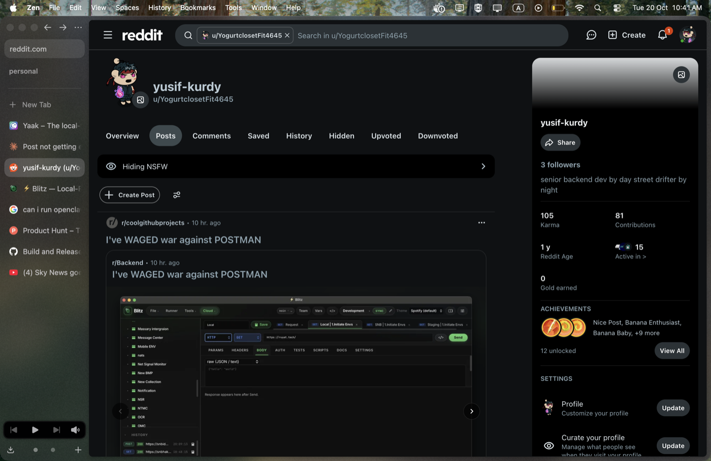

# ⚡ Blitz

<p align="center">
  
</p>

<p align="center">
  <strong>Lightweight, native Postman alternative built with Rust & Dioxus.</strong><br/>
  <em>Offline-first, multi-protocol (REST, gRPC, WebSocket, MQTT, SSE, MCP), ~10MB RAM runner, zero cloud lock-in.</em>
</p>

<p align="center">
  <a href="https://github.com/h3ma209/Blitz/releases"></a>
  <a href="https://github.com/h3ma209/Blitz/actions/workflows/build.yml"></a>
  <a href="LICENSE"></a>
  <a href="https://h3ma209.github.io/Blitz/"></a>
</p>

<p align="center">
  <a href="#downloads">Downloads</a> •
  <a href="#interface-preview">Interface</a> •
  <a href="#comparison">Comparison</a> •
  <a href="#key-features">Features</a> •
  <a href="#ci-cd-automation">CLI Runner</a> •
  <a href="#team-collaboration">Git Sync</a> •
  <a href="#license">License</a>
</p>

---

## 📸 Interface Preview

<p align="center">
  
</p>

---

## 📦 Downloads & Installation

### ⚡ 1-Line Quick Install

#### macOS
```bash
curl -fsSL https://raw.githubusercontent.com/h3ma209/Blitz/master/install.sh | bash
```
*Downloads latest DMG, installs to `/Applications/Blitz.app`, and automatically clears Gatekeeper quarantine.*

#### Linux
```bash
curl -fsSL https://raw.githubusercontent.com/h3ma209/Blitz/master/install.sh | bash
```
*Downloads latest binary and installs executable to `~/.local/bin/blitz`.*

#### Windows
**PowerShell:**
```powershell
irm https://raw.githubusercontent.com/h3ma209/Blitz/master/install.ps1 | iex
```
**Command Prompt (`curl`):**
```cmd
curl.exe -fsSL https://raw.githubusercontent.com/h3ma209/Blitz/master/install.ps1 -o install.ps1 && powershell -ExecutionPolicy Bypass -File install.ps1
```
**Git Bash / WSL:**
```bash
curl -fsSL https://raw.githubusercontent.com/h3ma209/Blitz/master/install.sh | bash
```
*Installs to `%LOCALAPPDATA%\Blitz\blitz.exe`, adds to User PATH, and creates Start Menu shortcut.*

### Homebrew Tap
```bash
brew tap h3ma209/blitz https://github.com/h3ma209/homebrew-blitz
brew install --cask blitz
```

### Direct Downloads
Pre-built binaries for macOS, Linux, and Windows are available directly from the **[Releases Page](https://github.com/h3ma209/Blitz/releases)**.

| Platform | Download | Package / Command |
|---|---|---|
| **macOS (Apple Silicon)** | [Blitz-macos-arm64.dmg](https://github.com/h3ma209/Blitz/releases/latest) | Drag to Applications |
| **macOS (Tarball)** | [blitz-macos-arm64.tar.gz](https://github.com/h3ma209/Blitz/releases/latest) | `tar -xzf blitz-macos-arm64.tar.gz` |
| **Linux (x86_64)** | [blitz-linux-x86_64.tar.gz](https://github.com/h3ma209/Blitz/releases/latest) | `tar -xzf blitz-linux-x86_64.tar.gz` |
| **Windows (x86_64)** | [blitz-windows-x86_64.zip](https://github.com/h3ma209/Blitz/releases/latest) | Unzip & run `blitz.exe` |
| **Cargo (Any OS)** | Source crate | `cargo install --git https://github.com/h3ma209/Blitz.git` |

### 🛡️ First-Launch Security Notice (macOS & Windows)

Because Blitz is an open-source project distributed without paid Apple Developer ($99/yr) or Windows EV enterprise certificates, your operating system may display a security verification warning on first manual launch.

#### 🍎 macOS Fix: *"Apple cannot verify that this app is free of malware"* or *"Blitz is damaged"*
Apple Gatekeeper attaches a quarantine attribute to files downloaded via web browsers.

**Method 1 — 1-Line Terminal Command (Recommended):**
```bash
xattr -cr /Applications/Blitz.app
```
*(If installed to user folder `~/Applications/Blitz.app`, run `xattr -cr ~/Applications/Blitz.app`)*

**Method 2 — GUI Right-Click:**
1. Open **Finder** → navigate to **Applications**.
2. **Right-click** (or `Control`-click) on **Blitz** and select **Open**.
3. Click **Open** in the confirmation prompt (macOS will remember this permanently).

**Method 3 — System Settings:**
Open **System Settings → Privacy & Security**, scroll down to the **Security** section, and click **Open Anyway**.

---

#### 🪟 Windows Fix: *"Windows protected your PC (SmartScreen)"*
Microsoft Defender SmartScreen flags newly downloaded open-source executables.

**Method 1 — GUI:**
1. On the *"Windows protected your PC"* popup, click **More info**.
2. Click **Run anyway**.

**Method 2 — PowerShell (Instant Unblock):**
```powershell
Unblock-File "$env:LOCALAPPDATA\Blitz\blitz.exe"
```
*(Or if downloaded zip: `Unblock-File .\blitz-windows-x86_64.zip` before unzipping)*

---

#### 🐧 Linux: *"Permission denied"*
Ensure the binary has executable permissions:
```bash
chmod +x ~/.local/bin/blitz
```

---

## ⚡ Comparison

| Feature | Postman | Bruno | Yaak | ⚡ Blitz |
|---|:---:|:---:|:---:|:---:|
| **Language / Architecture** | Electron + Node | Electron + Node | Tauri + React | **Pure Rust + Dioxus** |
| **Cold Start Latency** | ~3,500 ms | ~1,200 ms | ~450 ms | **< 150 ms** |
| **CLI Runner Footprint** | ~800 MB RSS | ~120 MB RSS | N/A | **~10.2 MB RSS** |
| **Account Mandatory** | Yes (forced cloud) | No | No | **No (100% offline)** |
| **Team Collaboration** | Cloud servers ($19+/user) | Git (.bru format) | Git / Sync | **Git-native (any remote)** |
| **Secret Storage** | Cloud / Local | Plaintext env | SQLite | **OS Keychain (Encrypted)** |
| **Built-in Mock Server** | Cloud hosted only | No | No | **Localhost 127.0.0.1** |
| **Traffic Proxy Capture** | Cloud proxy | No | No | **Local HTTP/HTTPS Proxy** |
| **License** | Proprietary | MIT | Fair-Core / Commercial | **MIT / Apache-2.0** |

---

## Why Blitz?

Most modern API clients have become bloated, memory-heavy cloud platforms that gate basic workflows behind subscriptions and force private endpoints onto remote servers.

Blitz is built from the ground up to be fast, private, and developer-friendly:

- **Ultra-lightweight:** Cold starts in ~120ms with a headless CLI runner that sits at ~10 MB RAM and a desktop GUI that uses native OS WebViews (no bundled Chromium or multi-process Electron bloat).
- **Offline-First & Local:** Collections, environments, and mocks live as transparent JSON files directly in your repository.
- **Zero Cloud Lock-in:** No forced logins, accounts, or telemetry. Your endpoints and tokens never leave your machine.
- **Git-Native Team Sync:** Collaborate with your team using standard Git workflows (`git pull` / `git push`) instead of per-seat cloud subscriptions.

---

## Key Features

### 🔌 Multi-Protocol Support
Interact with any modern API standard in one place:
- **REST / HTTP:** Query parameters, headers, GraphQL, form-data, multipart uploads.
- **WebSockets:** Interactive bidirectional streaming and frame inspection.
- **gRPC:** Unary calls and streaming with Protobuf schema reflection and decoding.
- **MQTT:** Real-time publish and subscribe to IoT brokers.
- **SSE (Server-Sent Events):** Live streaming event reader.
- **Socket.IO:** Native engine handshake and event listener.
- **MCP (Model Context Protocol):** Direct connection to AI agent tooling and context servers.

### 📑 Comprehensive Collection Workspace
Manage complex API suites with dedicated tabs:
- **Overview:** Collection documentation, structure preview, and real-time statistics.
- **Authorization:** Inherited authentication (Bearer, Basic, API Key, OAuth2) applied across child requests.
- **Pre-request & Test Scripts:** Collection-wide scripting for setup, teardown, and validation.
- **Variables:** Environment and collection variable scope resolution.
- **Runner:** Batch test execution with iteration controls, delays, and pass/fail diagnostics.

### 🧪 Postman-Compatible JavaScript Testing
Write familiar assertions and workflows locally without remote runtime limits:
- `blitz.test()` and `blitz.expect()` assertion suites.
- `blitz.sendRequest()` for chained requests and token pre-fetching.
- Built-in `CryptoJS` library (`SHA256`, `HmacSHA256`, `MD5`, Base64, Hex).
- Dynamic variables (`{{$guid}}`, `{{$timestamp}}`, `{{var}}`).

### 🔐 Secure Credential Storage
Protect sensitive environment secrets and tokens:
- Native OS Keychain integration (macOS Keychain, Linux Secret Service, Windows Credential Manager).
- Secrets stay encrypted locally and are automatically stripped before committing to Git remotes.

### 🔄 Seamless Migration & Local Mocks
- **Postman:** Import and export Postman v2.1 collections with full script fidelity.
- **OpenAPI:** Import and export OpenAPI 3.0 specifications.
- **cURL & HAR:** Paste raw terminal cURL commands or drop browser HAR files directly into the workbench.
- **Local Mock Server:** Instant zero-config HTTP mocks on `127.0.0.1` served from your saved examples.

---

## Quick Start

### Prerequisites
- [Rust Toolchain](https://rustup.rs/) (1.83+)
- macOS, Linux, or Windows

### Build and Run from Source
```bash
# Clone repository
git clone https://github.com/h3ma209/Blitz.git
cd Blitz

# Run debug build
cargo run

# Or run optimized release build
cargo run --release
```

### Install as Native Desktop App
```bash
make install
```

| Operating System | Default Install Destination | Uninstall |
|---|---|---|
| **macOS** | `~/Applications/Blitz.app` | `make uninstall` |
| **Linux** | `~/.local/share/blitz/` + `~/.local/bin/blitz` | `make uninstall` |
| **Windows** | `%LOCALAPPDATA%\Blitz\` | `powershell -File scripts/install.ps1 -Uninstall` |

---

## CI/CD Automation & AI Agent Integration

### Headless CLI Runner
Run test collections headless in your CI/CD pipelines without cloud subscriptions or proprietary API keys:

```bash
# Execute collection headless (returns exit code 0 on pass, 1 on failure)
blitz run collection.json --env staging.json
```

### 🤖 AI Agent Integration via MCP (Antigravity, Gemini, Claude, Cursor)
Blitz includes a built-in **Model Context Protocol (MCP)** server (`blitz mcp`), allowing AI coding assistants and autonomous agents to list collections, inspect request schemas, execute endpoints, and run API test suites directly through Blitz.

#### Setup in Antigravity / Gemini / Cursor / Claude:
Add Blitz to your `mcpServers` configuration (e.g. `~/.gemini/antigravity/mcp.json` or `claude_desktop_config.json`):

```json
{
  "mcpServers": {
    "blitz": {
      "command": "blitz",
      "args": ["mcp"]
    }
  }
}
```

#### Exposed MCP Tools:
- **`blitz_list_collections`**: Discover all collections, folders, and requests with folder breadcrumb paths (`path`, `folder`).
- **`blitz_get_request`**: Retrieve full request details (URL, headers, query params, body, auth).
- **`blitz_send_request`**: Execute a saved request through Blitz pipeline (returns parsed `json`, supports `save_to_env` auto-extraction, records history).
- **`blitz_execute_http`**: Run an ad-hoc HTTP request through Blitz engine (returns parsed `json`, supports `save_to_env` auto-extraction, records history).
- **`blitz_list_environments`**: List available environments, active state, and variable keys/values.
- **`blitz_set_env_var`**: Update or create an environment variable (e.g. auth token or baseUrl) directly from agent output.
- **`blitz_set_active_environment`**: Switch or clear the active environment.
- **`blitz_upsert_request`**: Create or edit request drafts in collections and folders.
- **`blitz_import_curl`**: Import raw cURL commands directly into collections.
- **`blitz_generate_code`**: Generate client code snippets (`cURL`, `Python`, `TypeScript`, `Rust`, `Go`, `Java`, `C#`) with variable interpolation.
- **`blitz_list_history`**: Query past request executions with status, latency, and timestamps.
- **`blitz_run_collection`**: Run a complete collection test suite (supports `folder` scoping) and return assertion results.

#### Exposed MCP Resources:
- `blitz://collections`: Hierarchy of all collections, folders, and requests.
- `blitz://environments`: Configured environments and variables.
- `blitz://active-env`: Currently active environment with resolved key-value pairs.
- `blitz://history`: Recent execution history.

---

## Team Collaboration via Git

Sync team workspaces directly through Git without cloud intermediaries:

1. **Link Git Remote:** In the top toolbar, select **Team → Link Git Remote…**
2. **Work Locally:** Add endpoints, edit environments, and write tests.
3. **Sync:** Click **Sync** — Blitz pulls changes, handles merges, and pushes through standard Git (SSH or `gh` CLI).
4. **Leak Prevention:** Passwords, tokens, and local secret variables are kept local and excluded from commits.

---

## License

Distributed under the MIT / Apache 2.0 open-source licenses. Not affiliated with or endorsed by Postman Inc.
