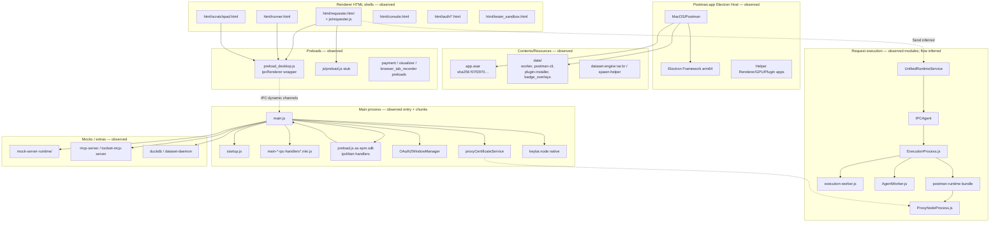

# 06a — Component / architecture diagram

Derived from REA inventory + Electron fuse/package observations. Solid boxes = **observed** artifacts; dashed = **inferred** roles.

## Notes

- IPC edges mostly **dynamic** — REA reported 0 statically paired transmissions.
- `BrowserWindow` construction not recovered (`browser_windows: 0`).
