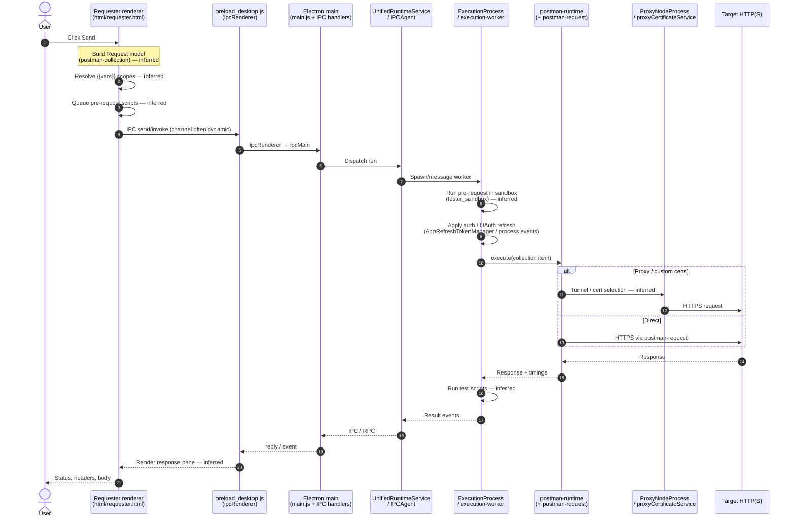

# 06b — Request lifecycle sequence

**Caution:** Sequence is **inferred** from observed module inventory + `postman-runtime` / Electron RPC dependencies. REA did **not** recover a complete static call graph from Send → HTTP (`request` family relations = 0 in focused analysis; large workers truncated).

## Observed anchors used

- HTML shell `requester.html`
- Preload IPC wrapper
- Modules: UnifiedRuntimeService, IPCAgent, ExecutionProcess, execution-worker, AgentWorker, postman-runtime bundle, ProxyNodeProcess, proxyCertificateService
- Deps: `postman-runtime`, `postman-request`, `@postman/runtime.runtime-rpc-electron`

## Not proven by REA

- Exact channel name for Send
- Exact order of var resolution vs scripts in this binary build
- Whether AgentWorker vs ExecutionProcess owns the socket
