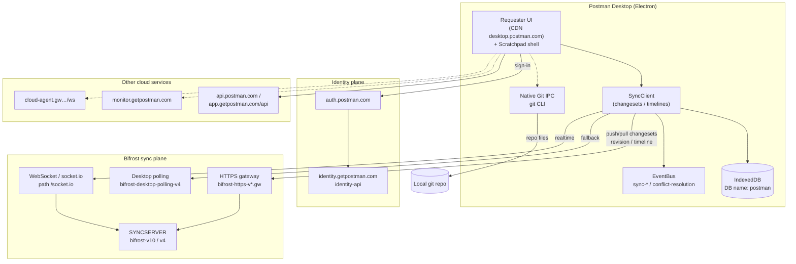
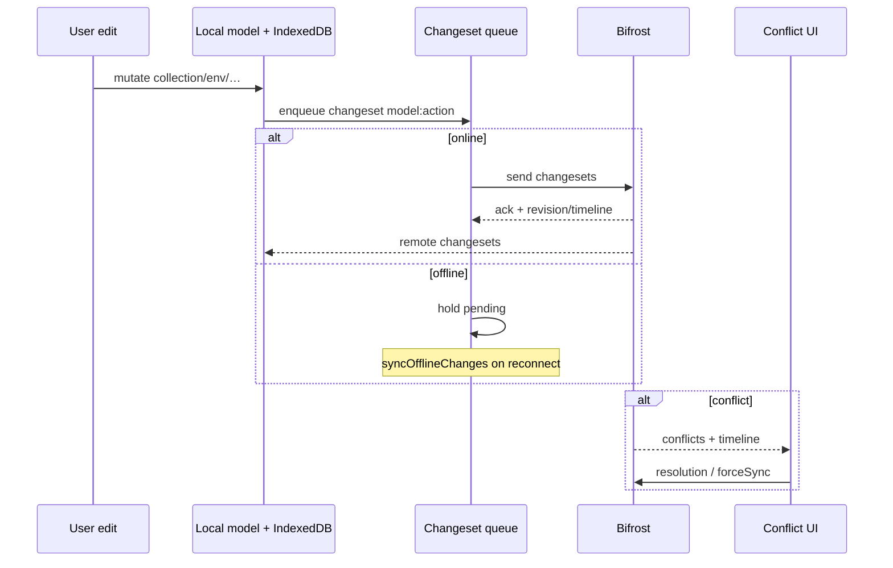

# 14a — Postman Cloud sync (desktop RE)

**Date:** 2026-10-17  
**Target:** Postman Desktop **12.32.4** (`/Applications/Postman.app`)  
**ASAR extract:** `.rea-scratch/re-complete-extract/app/`  
**REA:** `analyze_javascript_application` on auth/config/requester/offline HTML → parent `ev_a64944ae7e90306d5fce7fd132bde66b97b62c22914f89c2112be519a6c7e52e` (summary `ev_d2087bf28b59d2988f57e97d847aa397b63113d56c95a7b40cdeccb104c979cd`)  
**Prior:** reports 01–05, 10, 12, 13  

**Policy:** every claim **observed** (ASAR/strings/REA) or **inferred**. No credential dump, no account attack, no trademark/cloud-parity claim.

---

## Executive summary

Desktop ships a **local sync client** (rich strings in `js/scratchpad/scratchpad.js`) that talks to a service family branded **Bifrost** (`__WP_SYNCSERVER_URL__`, HTTPS gateways, desktop polling host). Identity is separate (`identity` / `auth` hosts). Primary requester UI JS is **CDN** (`desktop.postman.com`) — sync UX beyond scratchpad is only partially local.

**Observed:** changeset queue ↔ Bifrost; IndexedDB timelines/revisions; conflict-resolution bus; socket.io client; model types including collection/env/workspace.  
**Not recovered:** wire-format schema, server CRDT/OT algorithm, RBAC enforcement rules, full offline queue durability guarantees.

---

## 1. Identity / workspaces / roles (high level)

| Piece | Finding | Label |
|-------|---------|-------|
| Identity hosts | `__WP_IDENTITY_URL__` → `https://identity.getpostman.com`; `__WP_IDENTITY_API_URL__` → `https://identity-api.getpostman.com`; `__WP_GLOBAL_IDENTITY_URL__` → `https://auth.postman.com` | **observed** (`js/authentication.js`, `config.json`) |
| Auth UI shell | `html/auth/auth.html`, `js/authentication.js` | **observed** (report 05) |
| App / public API | `__WP_APP_URL__` → `https://app.getpostman.com`; `__WP_API_URL__` → `…/api`; `__WP_POSTMAN_API_URL__` → `https://api.postman.com` | **observed** |
| Workspace as sync model | string `model:"workspace"`, `model:"workspacesettings"`; many `Workspace` literals in scratchpad | **observed** |
| Roles / permissions | `model:"roles"`, `model:"permission"`; IndexedDB migration name `0021_clear_permissions` | **observed** (names only) |
| Team/SSO/SCIM/billing | not reconstructed as protocol | **unknown** from desktop alone |
| Build monorepo packages | `package.json` `workspaces` includes `../../data/workspace-data`, `workspace-scope`, `current-user`, `iam-external-identity`, `model-service` | **observed** (build metadata; not shipped as separate ASAR trees) |

**Inferred:** signed-in user session from identity hosts authorizes Bifrost; workspace is sync timeline scope. Role matrices live server-side.

---

## 2. What syncs (client model names)

Scratchpad sync logs / model literals (**observed**):

| Model string | Likely product entity | Notes |
|--------------|----------------------|-------|
| `collection` | Collection | primary |
| `folder` | Folder inside collection | |
| `request` | Request | |
| `response` | Saved example / response | |
| `environment` | Environment | |
| `globals` | Globals | |
| `history` | Request history | syncs as model — **not** proven as full cloud history product |
| `workspace` / `workspacesettings` | Workspace | |
| `collectionrun` | Collection run | |
| `user` / `session` | Account session | |
| `permission` / `roles` | ACL | |
| `editor` | UI editor state | may be local-heavy |
| `notification` / `notificationevent` | In-app notifications | |
| `apptheme` | Theme | |

Also present as product URLs (not proven as Bifrost model sync):

| Host / WP key | Role | Label |
|---------------|------|-------|
| `__WP_MONITORS_URL__` → `monitor.getpostman.com` | Cloud monitors | **observed** URL |
| Mock runtime under ASAR | Local/sim mock worker | **observed** paths (report 04) — cloud published mocks ≠ local worker |
| `__WP_PUBLISHING_SERVICE_URL__`, documenter hosts | Publish/docs | **observed** URLs |

**Inferred:** collections/envs/folders/requests/responses/globals/workspace settings are first-class sync entities. History/notifications may sync selectively. Cloud mocks/monitors are separate services.

---

## 3. Client sync loop

### 3.1 Architecture name: Bifrost + SyncClient

| Symbol / string | Meaning | Label |
|-----------------|---------|-------|
| `__WP_SYNCSERVER_URL__` | Sync server base | **observed** → prod `https://bifrost-v10.getpostman.com` (also v4 / beta / stage / preview variants in same bundle) |
| `__WP_POLLING_SERVER_URL__` | Desktop polling fallback | **observed** → `https://bifrost-desktop-polling-v4.getpostman.com` |
| `__WP_HTTPS_GATEWAY_PUBLIC_URL__` / `_PRIVATE_URL__` | HTTPS Bifrost gateways | **observed** → `bifrost-https-v{4,10}.gw.postman.com` / `.co` |
| `__WP_WEBSOCKET_URL__` | Realtime channel base | **observed** (env-templated + concrete bifrost hosts) |
| `__WP_HTTP_GATEWAY_URL__` / `__WP_ISTIO_GATEWAY_URL__` | Gateway front | **observed** → Istio `https://gateway.postman.com` |
| `window.postman_syncserver_url` | Scratchpad global from config | **observed** |
| `__WP_SYNC_RAWTEXT_LIMIT__` | Payload size cap | **observed** value `5242880` (5 MiB) |
| `__WP_DATABASE_NAME__` | Local DB name | **observed** `"postman"` |

Template form in main/auth: `__WP_SYNCSERVER_URL__: bifrost-gw.${domain}` (**observed**).

### 3.2 Changesets / timelines / revisions (**observed** scratchpad)

Local client language:

- **Changesets:** `addChangesets` / `removeChangesets` / `changesetsToServer` / `changesetsFromClient` / `sync-changeset-events`
- **Send path:** log lines `Started sending changeset for ${model}:${action}` / success / retryable drop
- **Force sync:** `forceSyncAllData`, `forceSyncCollectionAndContinue`, source `"force-sync"`
- **Offline:** `syncOfflineChanges`, checks for “unsynced local data”
- **Timeline:** `timeline`, `getTimelineId()`, subscribe/unsubscribe timeline per `model:modelId`
- **Revision:** `revision` numeric; `updated revision after /sync`; IndexedDB migration `0020_migrate_sync_client_revision`; default `{revision:0,timestamp:0}`
- **Watchdog:** Sync changeset queue / SyncClient command queue recovered by watchdog (60s)

**Inferred:** optimistic local apply → enqueue changeset → push to Bifrost → ack advances revision/timeline; pull applies remote changesets; disconnect drains offline queue on reconnect. Not proven: CRDT vs OT vs last-write-wins per field.

### 3.3 Conflict resolution (**observed**)

- Event bus: `epm.eventBus.channel("conflict-resolution")`
- UI namespace `"conflicts"` with `show` / `submit`; payload `{conflicts, timeline}`
- Paths: `conflictsResolved(resolution)`, edit-conflict messaging, `forceSyncAllData` after resolve
- Sync failure analytics category `"sync_failure"`

**Inferred:** server detects concurrent edits; client presents conflict UI; user resolution then continue or force-sync. Exact 3-way merge algorithm **unknown**.

### 3.4 Realtime transport (**observed**)

- `socket.io-client` + `engine.io-client` bundled in scratchpad; default path `"/socket.io"`; transports include `"polling"` and `"websocket"`
- Separate cloud agent WS: `__WP_CLOUD_AGENT_GATEWAY_WEBSOCKET_URL__` → `https://cloud-agent.gw.postman.com/ws` (**observed** — agent plane, not necessarily collection sync)
- Request-protocol websocket clients (`@postman/runtime.websocket-client`) are for **user API testing**, not Bifrost (**observed** package roles)

**Inferred:** Bifrost uses socket.io (or HTTP gateway + polling) for live sync; polling host is desktop fallback when WS blocked.

### 3.5 Local persistence (**observed**)

- IndexedDB / Dexie-style migrations (`IndexeddbSchemaMigration`, `IndexeddbDataMigration`)
- Tables/names referenced: `sync_clients`, timelines, editors keyed by workspace, etc.
- Database name config `"postman"`

### 3.6 Event-bus channels (**observed**)

`sync-changeset-events`, `sync-client`, `sync-manager-internal`, `sync-remote-fetch`, `sync-status`, `conflict-resolution`, `model-events`

---

## 4. Storage / API host patterns

### 4.1 Prod-ish map (**observed** from authentication.js env blocks)

| WP key | Example host |
|--------|----------------|
| Sync server | `bifrost-v10.getpostman.com` / `bifrost-v4.getpostman.com` |
| Desktop polling | `bifrost-desktop-polling-v4.getpostman.com` |
| HTTPS GW public | `bifrost-https-v10.gw.postman.com` |
| HTTPS GW private | `bifrost-https-v10.gw.postman.co` |
| Istio gateway | `gateway.postman.com` |
| Identity | `identity.getpostman.com`, `identity-api.getpostman.com` |
| Auth | `auth.postman.com` |
| App API | `app.getpostman.com/api` |
| Public Postman API | `api.postman.com` |
| Desktop UI CDN | `desktop.postman.com` |
| Live | `live.postman.com` |
| Monitors | `monitor.getpostman.com` |
| File / dataset | `file-service.postman.co`, `dataset-cloud.postman.co` |
| GitHub App (Native Git) | `https://github.com/apps/postman/installations/new` |

CORS / trusted: `client.postman.co`, `getpostman.com`, `postman.com`, … (**observed**).

### 4.2 Where sync logic lives

| Location | Sync relevance | Label |
|----------|----------------|-------|
| `js/scratchpad/scratchpad.js` | Full SyncClient / changeset language | **observed** |
| `js/authentication.js` | Env URL map for Bifrost/identity | **observed** |
| `js/requester.js` | **Absent** from ASAR; UI from `desktop.postman.com` | **observed** (prior reports) |
| `html/desktop-offline.html` + `js/desktop-offline.js` | Offline/webview shell | **observed** (title “Postman Webview”) |
| `main-git-ipc-handlers-*.min.js` + `services_git_GitResolver_*.min.js` | **Native Git** via local `git` CLI (status/checkout/push/…) — parallel to Bifrost | **observed** |

---

## 5. Offline / conflict behavior (observable)

| Behavior | Evidence | Label |
|----------|----------|-------|
| Offline queue drain | `syncOfflineChanges`, “unsynced local data” | **observed** |
| Retryable changeset drop | `retryable changeset failed. dropping changeset` | **observed** |
| Oversized create drop | create changeset dropped when response body exceeds limit (ties to `SYNC_RAWTEXT_LIMIT` 5 MiB) | **observed** / **inferred** linkage |
| Conflict UI channel | `conflict-resolution` + conflicts show/submit | **observed** |
| Force sync | `forceSyncAllData` | **observed** |
| Desktop offline shell | dedicated HTML/JS | **observed** |
| Durable queue across crash | IndexedDB sync_clients/timelines | **inferred** |

---

## 6. Mermaid — sync flow (desktop-observed)

**Sequence (inferred from observed names):**

---

## 7. Cannot know from desktop alone

Explicit unknowns (do **not** invent):

1. Exact Bifrost HTTP/WS message schemas and auth header shapes (without live capture / CDN requester).
2. Server conflict algorithm (CRDT / OT / LWW / custom) and merge field granularity.
3. Complete list of syncable models + which fields are server-authoritative.
4. Workspace RBAC matrix, SSO/SCIM, invite flows, billing gates.
5. Cross-region replication, retention, compliance.
6. Cloud mock/monitor/publish pipelines beyond URL presence.
7. Whether history sync is full transcript or metadata-only.
8. Parity between scratchpad SyncClient and CDN requester SyncClient (may diverge).
9. Live socket.io namespaces/rooms without runtime observation.
10. Credential/session token formats (out of scope; do not RE).

---

## 8. Evidence index

| Source | Role |
|--------|------|
| `.rea-scratch/re-complete-extract/app/js/authentication.js` | WP URL map, Bifrost hosts |
| `.rea-scratch/re-complete-extract/app/js/scratchpad/scratchpad.js` | SyncClient, changesets, conflicts, models |
| `.rea-scratch/re-complete-extract/app/config.json` | Identity / desktop CDN / tunnel |
| `main-git-ipc-handlers-*.min.js`, `services_git_GitResolver_*.min.js` | Native Git |
| REA parent evidence | `ev_a64944ae7e90306d5fce7fd132bde66b97b62c22914f89c2112be519a6c7e52e` |
| Reports 04, 05, 12, 13 | Prior sync gaps / identity |

---

## 9. Implication for notPostman

Do **not** clone Bifrost. Desktop already shows Postman’s own **escape hatch**: Native Git IPC. notPostman team sync → **git-based file layout** (see sibling `git-team-sync-design.md`).
